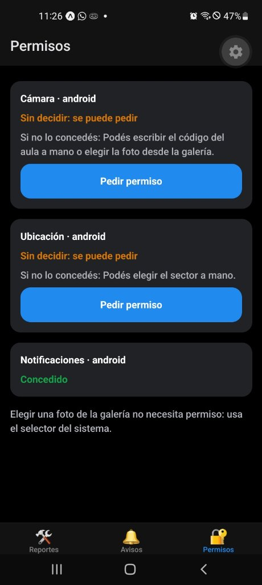
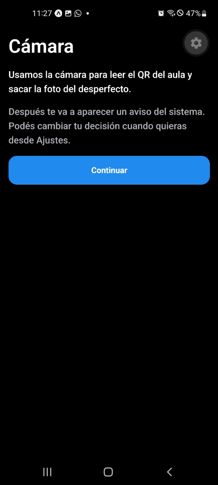
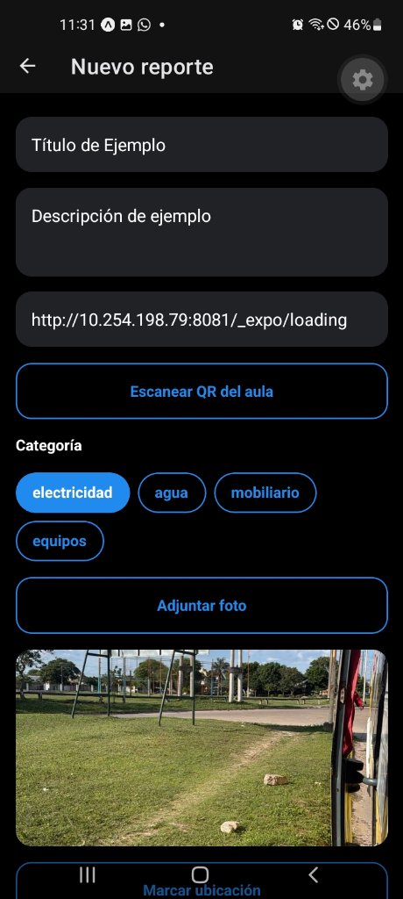
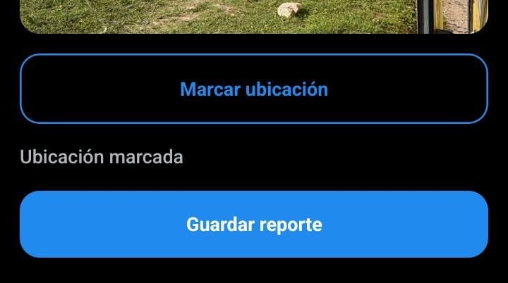
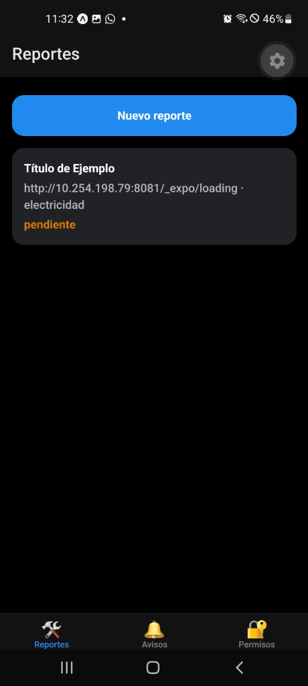
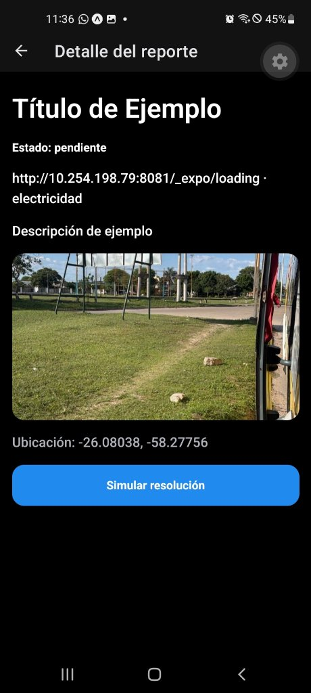
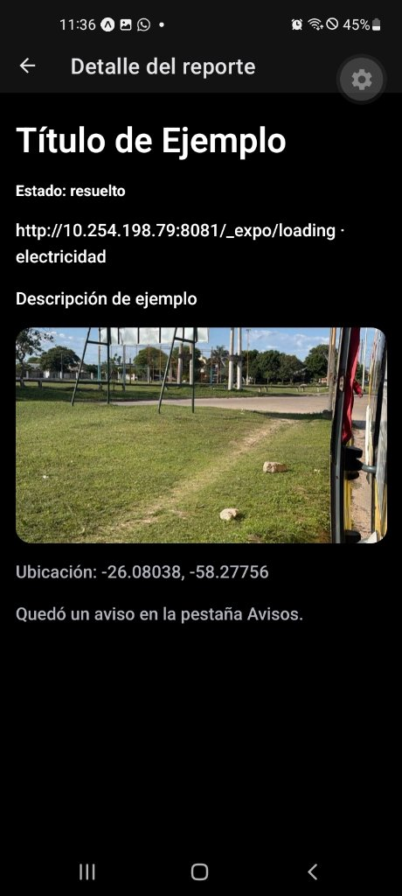
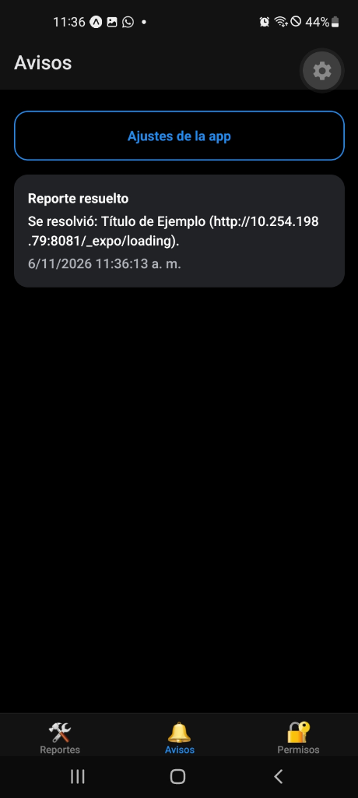

# Mantenimiento IPF 🛠️
> **Trabajo Práctico N° 3 — Programación en Nuevas Tecnologías (React Native / Expo)**  
> Aplicación móvil para el reporte y seguimiento de desperfectos e incidencias edilicias del Instituto Politécnico Formosa (IPF), implementando una **política estricta de menor privilegio** en el acceso a recursos del dispositivo y una **capa de abstracción de permisos de 4 estados**.

---

## 📋 Índice
1. [Descripción del Proyecto](#-descripción-del-proyecto)
2. [Política de Menor Privilegio](#-política-de-menor-privilegio)
   - [Recursos y Purpose Strings](#recursos-utilizados-y-propósitos-purpose-strings)
   - [Permisos Bloqueados y Justificación Técnica](#permisos-bloqueados-blockedpermissions)
3. [Arquitectura de la Capa de Permisos](#-arquitectura-de-la-capa-de-permisos)
   - [Los 4 Estados Canónicos](#los-4-estados-canónicos)
   - [Permisos Parciales](#permisos-parciales)
   - [Patrón Pre-Permission Modal (Directrices Apple)](#patrón-pre-permission-modal-directrices-apple)
   - [Revisión Reactiva al Volver de Ajustes](#revisión-reactiva-al-volver-de-ajustes)
4. [Estructura del Proyecto](#-estructura-del-proyecto)
5. [Galería de Evidencias y Capturas](#-galería-de-evidencias-y-capturas)
6. [Instrucciones de Instalación y Uso](#-instrucciones-de-instalación-y-uso)

---

## 📌 Descripción del Proyecto

**Mantenimiento IPF** permite a docentes, alumnos y personal no docente reportar problemas edilicios o de equipamiento (eléctricos, mobiliario, sanitarios, etc.) de manera rápida y transparente:
- **Lectura rápida de aula:** Escaneo de códigos QR en las puertas o ingreso manual de código alternativo.
- **Evidencia visual:** Captura fotográfica con la cámara o selección desde la galería utilizando el **selector nativo del sistema** (sin requerir permisos invasivos de fotos).
- **Geolocalización:** Registro de coordenadas GPS en primer plano con soporte para ubicación aproximada y alternativa de selección manual de sectores (Patio, Baños, Biblioteca, etc.).
- **Ciclo de vida y avisos:** Seguimiento del estado (*pendiente*, *en curso*, *resuelto*), simulación de resolución técnica y recepción de avisos internos.

---

## 🛡️ Política de Menor Privilegio

La aplicación sigue el principio de **privilegios mínimos** (*Least Privilege*): solo se solicitan los permisos estrictamente necesarios en el momento en que el usuario los necesita (*just-in-time*), ofreciendo alternativas viables si el usuario decide denegarlos.

### Recursos Utilizados y Propósitos (*Purpose Strings*)

| Recurso | Plugin Expo | Clave de Propósito / Configuración | Texto explicativo al usuario | Alternativa sin permiso |
| :--- | :--- | :--- | :--- | :--- |
| **Cámara** | `expo-camera` | `cameraPermission` | *"Usamos tu cámara para leer el QR del aula y sacar la foto del desperfecto que vas a reportar."* | Escribir código de aula a mano y adjuntar foto vía selector de galería. |
| **Ubicación** | `expo-location` | `locationWhenInUsePermission` | *"Usamos tu ubicación para marcar en qué sector del instituto está el desperfecto."* | Selección manual del sector mediante chips interactivos. |
| **Notificaciones** | `expo-notifications` | Canal de notificaciones en Android | *"Te avisamos cuando se resuelva tu reporte."* | Bandeja interna de avisos en la pestaña "Avisos". |
| **Galería** | `expo-image-picker` | `photosPermission: false` | *No se solicita permiso.* | Se utiliza el Photo Picker nativo del sistema operativo. |

### Permisos Bloqueados (`blockedPermissions`)

En `app.json` se configuró explícitamente la lista negra de permisos para evitar que bibliotecas de terceros o herramientas de empaquetado inyecten permisos excesivos en el `AndroidManifest.xml`:

| Permiso Bloqueado en Android | Justificación Técnica de Seguridad |
| :--- | :--- |
| `android.permission.RECORD_AUDIO` | La app reporta fallas visuales o descriptivas. No graba audio ni notas de voz. |
| `android.permission.MODIFY_AUDIO_SETTINGS` | La app no reproduce música ni manipula el volumen del hardware. |
| `android.permission.READ_EXTERNAL_STORAGE` | Invasivo y obsoleto. Se usa el Photo Picker del sistema que no requiere acceso al almacenamiento global. |
| `android.permission.WRITE_EXTERNAL_STORAGE` | La app no guarda archivos en almacenamiento compartido no seguro. |
| `android.permission.READ_MEDIA_IMAGES` | Se previene acceso a la biblioteca entera de fotos del usuario. |
| `android.permission.READ_MEDIA_VIDEO` | No se procesan ni adjuntan videos. |
| `android.permission.READ_MEDIA_AUDIO` | No se requiere lectura de archivos musicales. |
| `android.permission.READ_MEDIA_VISUAL_USER_SELECTED` | El selector de fotos desacoplado del sistema opera sin permisos permanentes en el manifest. |
| `android.permission.ACCESS_BACKGROUND_LOCATION` | La ubicación solo se requiere al crear el reporte en primer plano. No se rastrea al usuario en segundo plano. |
| `android.permission.SYSTEM_ALERT_WINDOW` | La app no dibuja ventanas flotantes sobre otras aplicaciones. |

---

## ⚙️ Arquitectura de la Capa de Permisos

La lógica se encuentra modularizada en [`src/lib/permisos.ts`](file:///C:/Users/IPF-2026/Desktop/Trabajo%20Practico%20N3%20de%20React/mantenimiento-ipf/src/lib/permisos.ts) y hooks dedicados.

### Los 4 Estados Canónicos

La app traduce cualquier respuesta nativa de la plataforma a uno de 4 estados consistentes:

```
┌──────────────┐
│   cargando   │  -> Consultando estado nativo de forma asíncrona.
└──────┬───────┘
       │
       ├─────────────────────────┐
       ▼                         ▼
┌──────────────┐          ┌──────────────┐
│  concedido   │          │  preguntable │  -> El sistema permite mostrar el diálogo.
└──────────────┘          └──────┬───────┘
                                 │ (Si el usuario rechaza y no se puede volver a pedir)
                                 ▼
                          ┌──────────────┐
                          │   bloqueado  │  -> Requiere guiar al usuario a Ajustes.
                          └──────────────┘
```

1. **`cargando`**: Estado inicial mientras se consultan las APIs del dispositivo sin bloquear la UI.
2. **`concedido`**: El recurso está disponible para ser utilizado de inmediato.
3. **`preguntable`**: Aún no se ha pedido o el sistema permite mostrar el diálogo nativo.
4. **`bloqueado`**: El usuario denegó el permiso permanentemente (*"No volver a preguntar"* en Android o denegación en iOS). La única vía de recuperación es a través de la configuración del sistema.

### Permisos Parciales
La función `esParcial(recurso, respuesta)` contempla particularidades modernas de los sistemas operativos:
- **Android:** Ubicación aproximada (`accuracy === 'coarse'`). La app informa que la ubicación es aproximada y no muestra coordenadas exactas.
- **iOS:** Notificaciones provisionales (`status === IOS_PROVISIONAL`). Se avisa que se entregarán silenciosamente.

### Patrón Pre-Permission Modal (Directrices Apple)
Siguiendo la directriz **App Store Review Guideline 5.1.1(iv)**, el componente [`PrevioPermiso`](file:///C:/Users/IPF-2026/Desktop/Trabajo%20Practico%20N3%20de%20React/mantenimiento-ipf/src/components/previo-permiso.tsx):
- Presenta el **beneficio del permiso en una sola frase clara**.
- Incluye un **único botón de acción ("Continuar")**. No contiene botones confusos ni engañosos como "Ahora no" o "Cancelar".
- Si el recurso está **bloqueado**, la pantalla se adapta dinámicamente: explica que el sistema no permite volver a preguntar, muestra la ruta exacta de Ajustes (`Ajustes > Aplicaciones > Mantenimiento IPF > Permisos`) y provee un botón directo **"Abrir Ajustes"** vía `Linking.openSettings()`.

### Revisión Reactiva al Volver de Ajustes
El hook [`useRevisarAlVolver`](file:///C:/Users/IPF-2026/Desktop/Trabajo%20Practico%20N3%20de%20React/mantenimiento-ipf/src/hooks/useRevisarAlVolver.ts) escucha los cambios de estado en `AppState`. Cuando el usuario sale de la aplicación para habilitar o deshabilitar un permiso en los Ajustes del sistema y vuelve a la app, el estado se re-evalúa y la interfaz se actualiza automáticamente sin requerir reinicios.

---

## 📁 Estructura del Proyecto

```text
mantenimiento-ipf/
├── app.json                     # Configuración de Expo, plugins, strings y blockedPermissions
├── package.json                 # Dependencias (Expo SDK 58, React 19, React Native 0.86)
├── tsconfig.json                # Configuración de TypeScript con typedRoutes
├── assets/
│   ├── images/                  # Iconos y splash screen
│   └── screenshots/             # Evidencias fotográficas del TP
└── src/
    ├── app/                     # Enrutamiento basado en archivos (Expo Router)
    │   ├── _layout.tsx          # Layout raíz con configuración de tema y notificaciones
    │   ├── ajustes-app.tsx      # Ajustes de canales de avisos y notificaciones
    │   ├── (tabs)/              # Navegación por pestañas inferior
    │   │   ├── _layout.tsx      # Configuración de pestañas (Reportes, Avisos, Permisos)
    │   │   ├── index.tsx        # Lista de reportes generados
    │   │   ├── avisos.tsx       # Bandeja de avisos y notificaciones recibidas
    │   │   └── permisos.tsx     # Panel de control de estados de permisos en vivo
    │   ├── permisos/
    │   │   └── [recurso].tsx    # Pantalla modal previa a la solicitud del permiso
    │   └── reporte/
    │       ├── _layout.tsx      # Stack de navegación para el wizard de reporte
    │       ├── nuevo.tsx        # Formulario principal de nuevo reporte
    │       ├── escanear.tsx     # Escáner de código QR de aula (CameraView)
    │       ├── foto.tsx         # Captura de foto con cámara o selección de galería
    │       ├── ubicacion.tsx    # Geolocalización GPS y selección manual de sector
    │       └── [id].tsx         # Vista de detalle y simulación de resolución
    ├── components/              # Componentes reutilizables
    │   ├── boton.tsx            # Botón con variantes primaria, secundaria y loading
    │   ├── campo.tsx            # Input de texto estilizado
    │   ├── pantalla.tsx         # Contenedor seguro con ScrollView y SafeArea
    │   ├── previo-permiso.tsx   # Modal de explicación pre-permiso
    │   ├── themed-text.tsx      # Texto adaptativo a tema claro/oscuro
    │   └── themed-view.tsx      # Vista adaptativa
    ├── hooks/
    │   ├── usePermiso.ts        # Hook principal de estado y solicitud de permisos
    │   ├── useRevisarAlVolver.ts# Listener de AppState para re-chequeo automático
    │   └── use-theme.ts         # Hook de paleta de colores
    └── lib/
        ├── almacen.ts           # Almacén en memoria: borrador, lista de reportes y avisos
        ├── notificaciones.ts    # Configuración de canal de notificaciones seguro
        ├── permisos.ts          # Abstracción de permisos, mapeo a 4 estados y rutas de ajustes
        └── ubicacion.ts         # Wrapper de lectura de ubicación con fallback
```

---

## 📸 Galería de Evidencias y Capturas

A continuación se presentan las capturas obtenidas en un dispositivo real ejecutando la aplicación:

| 1. Panel de Permisos | 2. Pantalla Previa (Pre-permission) |
| :---: | :---: |
|  |  |
| *Estados en vivo: Cámara y Ubicación preguntables; Notificaciones concedidas.* | *Beneficio claro en una frase y único botón "Continuar".* |

| 3. Formulario de Reporte con QR y Foto | 4. Ubicación y Guardar Reporte |
| :---: | :---: |
|  |  |
| *Aula cargada automáticamente tras escanear el QR y foto adjuntada.* | *Geolocalización GPS fijada y acción de guardado.* |

| 5. Lista de Reportes | 6. Detalle del Reporte |
| :---: | :---: |
|  |  |
| *Tarjeta de reporte creada con estado "pendiente" en color ámbar.* | *Visualización de datos completos, foto y botón "Simular resolución".* |

| 7. Resolución Simulada | 8. Bandeja de Avisos |
| :---: | :---: |
|  |  |
| *Estado actualizado a "resuelto" tras la intervención técnica.* | *Recepción del aviso interno con fecha y hora de resolución.* |

---

## 🚀 Instrucciones de Instalación y Uso

### Prerrequisitos
- Node.js (versión 18 o superior recomendada).
- Gestor de paquetes `npm`.
- Dispositivo móvil con la aplicación **Expo Go** (SDK 58) instalada o cliente de desarrollo.

### 1. Clonar el repositorio e instalar dependencias
```bash
git clone <URL_DEL_REPOSITORIO>
cd mantenimiento-ipf
npm install
```

### 2. Iniciar el servidor de desarrollo (Metro)
```bash
npx expo start
```
*Para forzar la limpieza de caché:*
```bash
npx expo start -c
```

### 3. Ejecutar en el dispositivo
1. Conecta tu teléfono móvil a la misma red Wi-Fi que tu computadora.
2. Abre la app **Expo Go** en Android y escanea el código QR mostrado en la terminal (o ingresa la URL `exp://...`).
3. Navega por las pestañas para auditar los permisos, crear nuevos reportes y simular resoluciones.
